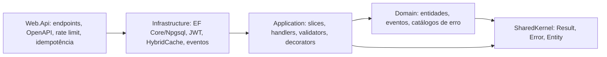

# Visão geral da arquitetura

Monolito em **Clean Architecture** com casos de uso em vertical slices ([[ADR-0002-clean-architecture]]). Código em `app/src`, testes em `app/tests`, solução `CleanArchitecture.slnx`.

As setas são referências de projeto; as fronteiras são verificadas por `app/tests/ArchitectureTests`.

## Fluxo de uma requisição

1. Endpoint (`IEndpoint`) mapeia a requisição para um command/query.
2. `ValidationDecorator` (commands) → `LoggingDecorator` → handler.
3. Handler usa `IApplicationDbContext`, `IUserContext`, `IDateTimeProvider`; mutações levantam eventos de domínio.
4. `SaveChangesAsync` despacha eventos de domínio para `IDomainEventHandler<T>`.
5. `Result` volta ao endpoint → `result.Match(Results.Ok, CustomResults.Problem)` (`ProblemDetails` em falha).

## Infraestrutura local

`docker compose up -d`: `postgres` (17) + `observability` (Grafana LGTM). Ver [[RB-001-ambiente-local]] e [[Observability]].
